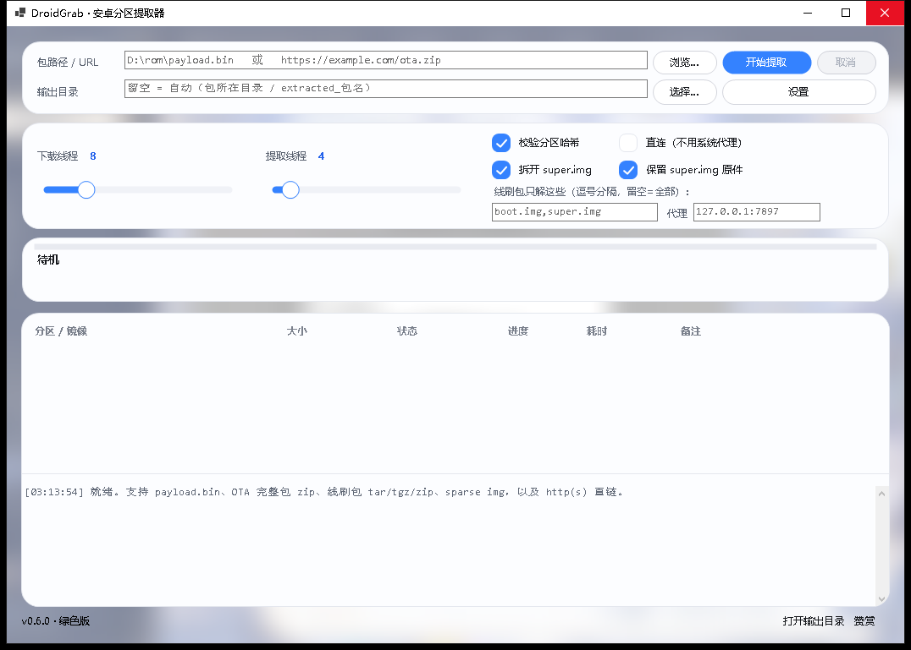

# DroidGrab · 安卓分区提取器

Windows 桌面版 Android 分区提取工具。从 OTA 包、`payload.bin`、线刷包、`sparse` 镜像或 http(s) 直链中取出分区镜像，输出为可直接刷写的 `*.img`。

> 只想知道怎么用，看 [MANUAL.md](MANUAL.md)（使用手册：界面布局、每个开关管什么、出错怎么办）。本文件讲技术规格、构建方式与已知限制。

技术栈为 C# / .NET 8 + WinForms，发布形态是自包含单文件绿色版，无需安装 .NET 运行时。当前版本 0.6.0。

本项目基于手机端的 Python 工具 `payload_dumper` 二次开发（二改）：分区提取流程与 CrAU / protobuf 解析思路沿用原项目，执行方式由「逐个 `InstallOperation` 串行发 HTTP Range 请求、单线程落盘」改为「按需拉取要用的区间、多个 Range 请求同时在飞」，分区之间与 operation 之间并行提取；在此基础上补上图形界面、线刷包 / `super` / `sparse` 支持与自动升降档。代码为 C# 独立实现，未复制原项目源码。

## 支持的输入

| 输入 | 处理方式 |
| --- | --- |
| `payload.bin` | 解析 CrAU 头与 protobuf manifest |
| OTA `*.zip`（payload.bin 为 stored） | 原地按需读取，不整体解压 |
| OTA `*.zip`（payload.bin 被压缩存放） | 解到临时文件后处理 |
| 线刷包 `*.tar` / `*.tgz` / `*.zip` | 流式解包，只落选中的镜像；`tar` / `tgz` 走单连接顺序读取（gzip 流不可随机跳读） |
| `super.img` | 按 LP metadata 拆出逻辑分区，`_a` / `_b` 后缀自动归并 |
| `sparse` 镜像 | 展开为 raw |
| http(s) 直链 | 按需分块拉取；线刷包边下边解，不落地整包 |

包类型按文件内容（magic）判断，不依赖扩展名。

压缩与操作类型：`xz`、`bz2`、`brotli`，以及 `REPLACE` / `REPLACE_XZ` / `REPLACE_BZ` / `ZERO` / `DISCARD`。`BSDIFF` / `PUFFDIFF` / `ZUCCHINI` 等增量补丁操作不支持，遇到时报错，而不是产出错误数据。

## 主要功能

- **按需拉取**：只拉取 manifest 和真正要提取的数据块，不下载整包；以 2 MB 为单位按需请求区间。并发对象是同时在飞的 HTTP Range 请求数，由 `IO/IRandomReader.cs` 的闸门控制，许可只在一次 HTTP 尝试期间持有。
- **并发上限可调**：上限由界面滑块设定，范围 1–32，运行中拖动立即生效；环境变量 `PDP_CONNECTIONS` 同样在运行时覆盖（每次取许可前重读，终值夹在 1–32）。本地回环 HTTP Range 服务实测：上限 1 时实测峰值 1、上限 4 时实测峰值 4（22.06 MB 样本分 12 块并发读，读回内容与源文件逐字节一致）。
- **自动升降档**：按实测吞吐调整档位——吞吐下滑超过 30% 减半、回升超过 20% 逐档加回、连续三次采样低于 400 KB/s 且档位大于 1 时再降一档；档位不超过用户设定值，设置里的「自动降档」关掉后只按用户设定跑。调档会写日志。
- **空闲自动重连**：单次 Range 请求空闲 30 秒无数据即超时重连；每读到一段数据就把空闲计时往后推，慢速链路不会被误杀。
- **统一随机读**：本地文件与 HTTP 直链共用同一套随机读接口；读元数据（zip 尾部、中央目录、manifest）时只请求需要的字节，不做整块预取。
- **并行提取**：分区之间、operation 之间并行；下载并发与提取并发可分别设置。
- **校验**：分区级 sha256 默认开启；单个 operation 的 `data_sha256_hash` 可选（较慢，默认关闭）。
- **super / sparse 处理**：`super.img` 可拆出逻辑分区并可保留原件（默认保留）；`sparse` 镜像自动展开。
- **分区选择**：提取前可勾选分区、搜索过滤、一键清空、「常用」一键选中；线刷包可指定只解哪些镜像，全部命中后立即停止下载。
- **界面**：自绘控件（卡片、大圆角、复选框、滑块、按钮），风格取小米「贴片」，窗体背景为屏幕截图的降采样模糊；进度区分两行，第一行是当前分区进度，第二行是速度与总量；结果表固定六列——分区 / 镜像、大小、状态、进度、耗时、备注，失败行整行标红，双击某行可在资源管理器里定位对应镜像；另有日志区。提取进行中关闭窗口会先弹确认框（标题「还在提取」，默认按钮是「否」），确认后取消提取并最多等 3 秒收尾。



## 系统要求

- Windows 10（1607 及以上）/ Windows 11，x64
- 开发与实测环境为 Windows 10 IoT Enterprise LTSC 2021（19044）；Windows 11 未做实机验证
- 无需安装 .NET 运行时：发布产物为自包含单文件；按普通用户权限运行，不提权
- 高 DPI 屏按 Per-Monitor V2（`ApplicationHighDpiMode`）处理
- 首次启动会把原生库解压到 `%TEMP%\.net`，冷启动约 1–2 秒

## 使用方法（图形界面）

1. 拖入文件、粘贴直链，或点「浏览…」选择输入。
2. 选择输出目录；留空时输出到包所在目录的 `extracted_<包名>` 文件夹。
3. 需要时点「选择…」勾选分区，或在选项区填写线刷包只解哪些镜像。
4. 用滑块设置下载并发（在飞 Range 请求数上限；GUI 初值 = `Math.Clamp(Environment.ProcessorCount * 2, 8, 16)`，出厂配置值 16）与提取并发（初值等于 CPU 核数），范围均为 1–32；`PDP_CONNECTIONS` 环境变量在运行时覆盖下载并发，终值夹在 1–32。
5. 点「开始提取」；过程中可「取消」，点击后立即生效。提取进行中关闭窗口会先弹确认框，默认按钮是「否」。
6. 完成后弹出耗时提示，「打开输出目录」可直接定位到结果目录，双击结果表的某一行可在资源管理器里选中该镜像。

选项区可开关：校验分区哈希、直连（不用系统代理）、拆开 `super.img`、保留 `super.img` 原件，并可填写代理与线刷包镜像名单。设置对话框里可修改 User-Agent、Referer、Cookie 与自动降档。

## 命令行

```text
DroidGrab.exe <输入> --auto --out <目录> [--parts boot,vendor]
```

| 参数 | 说明 |
| --- | --- |
| `<输入>` | 本地文件路径或 http(s) 直链 |
| `--auto` | 不弹完成提示，直接跑完（供脚本调用） |
| `--out` | 输出目录 |
| `--parts` | 只提取指定分区，逗号分隔 |

命令行只解析以上参数，也接受 `--out=目录` / `--parts=a,b` 写法；`--out` 与 `--parts` 的值不会被当成输入源。不认识的 `--` 参数会弹出提示并直接退出（退出码 2），不会把参数后面的值当成输入源（`Program.cs`）。并发度通过界面滑块或环境变量 `PDP_CONNECTIONS` 控制（取值 1–32）；`PDP_CONNECTIONS` 在运行时改也立即生效，终值夹在 1–32。

## 输出物

- 分区镜像 `<分区名>.img`，写在输出目录根部。
- 线刷包保留归档内的目录层级（如 `images/boot.img`）；同名文件已存在时追加 `_1`、`_2` 序号。
- `super.img` 拆出的逻辑分区以分区名命名；与已有同名镜像冲突时加 `super_` 前缀。
- `settings.json` 位于 exe 同目录；该目录不可写时退到 `%LOCALAPPDATA%\PayloadDumperPlus`。
- 界面日志可写盘：设置环境变量 `PDP_LOG` 指定日志文件路径。

## 已知限制

- 只做提取，不做重打包。
- 增量 OTA（`partial_update`）不支持，需要全量包。
- 不做 metadata 签名校验。
- 不解析 ext4 / erofs 内部结构，没有文件级浏览。
- 华为 `UPDATE.APP`、高通 `rawprogram.xml` 这类厂商封装未支持。
- 三星 `tar.md5`（带 md5 校验的线刷包）与 MTK 散装目录尚未支持。
- 仅支持 Windows；不提供 macOS、Linux 与手机端版本。

## 构建

需要 .NET 8 SDK。发布参数（win-x64 / 自包含单文件 / 压缩 / 无调试符号）已固化在 `src/PayloadDumperPlus.App/PayloadDumperPlus.App.csproj`，无需手写一长串命令行。

```bash
dotnet build
dotnet run --project tests/PayloadDumperPlus.Tests
dotnet publish src/PayloadDumperPlus.App/PayloadDumperPlus.App.csproj -c Release
```

产物为 `dist/DroidGrab.exe`。自测样本由 `tests/PayloadDumperPlus.Tests/make_sample_payload.py` 用 Python 标准库现场生成。

## 致谢

- **[vm03](https://github.com/vm03/payload_dumper)** —— 手机端 Python 版 `payload_dumper` 的作者。本项目的分区提取流程与 CrAU / protobuf 解析思路源自该项目，感谢原作者的开创工作。原项目未声明开源许可证；本项目为 C# 独立实现，未复制其源码。
- **SakuraTears** —— 需求、真机测试、界面设计与验收。
- **DeepSeek** —— 代码实现与文档。

## 许可

MIT，见 `LICENSE`。
